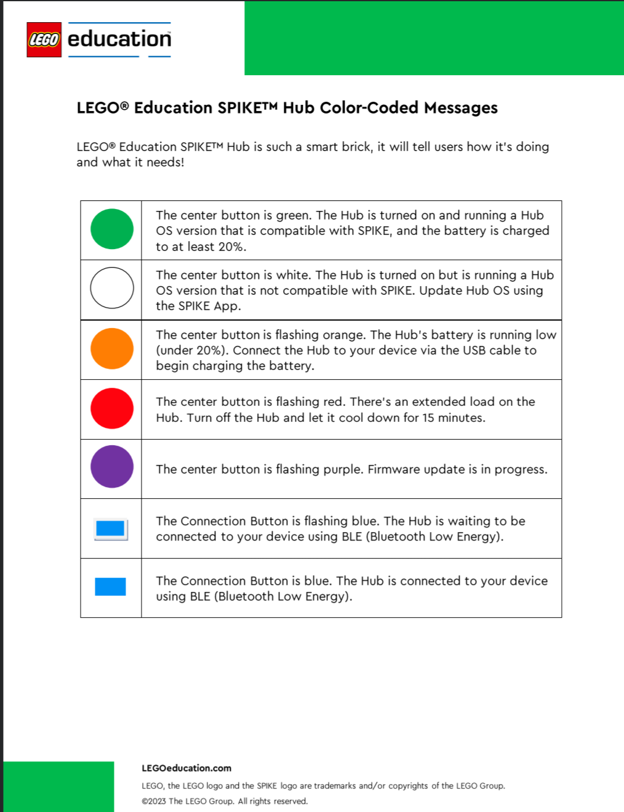

# SPIKE Prime hub lights

Read **which button**, **which color**, and **whether it flashes**. These are hardware status lights. The letter shown by `signal("Y")` on the 5×5 display is a separate program output.

| Button | Color and pattern | Meaning and action |
|---|---|---|
| Center | Green, steady | Hub is on, its OS is compatible with SPIKE, and battery is at least 20%. Still check the correct hub connection, program and clear lane before running. |
| Center | White, steady | Hub OS needs an update to work with SPIKE. Ask the mentor to follow the app's update instructions. |
| Center | Orange, flashing | Battery is below 20%. Tell the mentor and connect the USB cable to charge. |
| Center | Red, flashing | Extended load. Stop, tell the mentor, switch the hub off and let it cool for 15 minutes. |
| Center | Purple, flashing | Firmware update is in progress. Let the update finish and follow the app instructions. |
| Connection | Blue, flashing | Waiting for a Bluetooth connection. Check the intended hub name with the mentor. |
| Connection | Blue, steady | Connected by Bluetooth. This is not a battery-level indication. |

Use the printed color name and pattern as well as the color. A gray or black-and-white printout still communicates the meaning. These meanings apply to the **SPIKE Prime large hub** used in this course, not every LEGO hub.

Source: the LEGO Education color-coded message sheet supplied by Alex on October 25, 2026, cross-checked against [LEGO's SPIKE Prime hub FAQs](https://education.lego.com/en-us/product-resources/spike-prime/troubleshooting/spike-prime-faqs/). The reference image below retains its original LEGO attribution.

[Open the printable PDF](SPIKE_Hub_Color_Guide.pdf). The table and original image above are directly readable on GitHub; no clone is needed.
